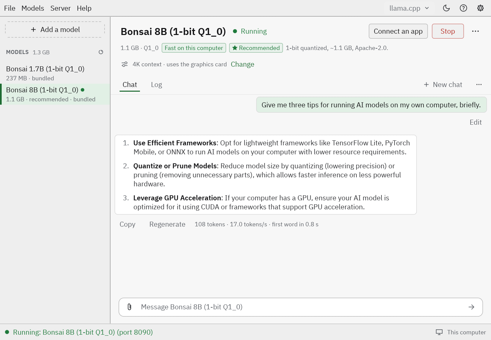

<p align="center">
  
</p>

<h1 align="center">QuickAI</h1>

<p align="center">
  <strong>Run AI models on your own computer. Private by default.</strong>
</p>

<p align="center">
  <a href="https://github.com/everybodyai/quickai/actions/workflows/ci.yml"></a>
  <a href="LICENSE"></a>
  
</p>

<p align="center">
  <a href="https://everybodyai.dev/quickai">Website</a> ·
  <a href="#install">Install</a> ·
  <a href="#quick-start">Quick start</a> ·
  <a href="docs/README.md">Docs</a> ·
  <a href="COMMERCIAL.md">Commercial use</a>
</p>

<p align="center">
  <picture>
    <source media="(prefers-color-scheme: dark)" srcset="assets/readme/quickai-dark.png">
    
  </picture>
</p>

QuickAI is a small desktop app that downloads, runs and manages AI models on the hardware you already have:
chat, code, vision, speech, documents, images and video. There's no account, no cloud and no telemetry, and your
prompts never leave your computer.

## Why QuickAI

- **Private by default.** The models run on your computer, and the servers QuickAI starts listen on `127.0.0.1`
  only. No telemetry, no accounts, no update checks. It uses the internet only when you click something that
  needs it. [PRIVACY.md](PRIVACY.md) lists every host it can contact, and why.
- **Works out of the box.** It ships with llama.cpp and Bonsai 2 4B (ternary weights, 1.2 GB), so your first
  chat needs no download at all.
- **Runs on ordinary hardware.** GPU acceleration through Vulkan on AMD, NVIDIA and Intel. QuickAI suggests a
  model that fits your memory and estimates how fast it will run before you start it.
- **80+ recommended models.** A curated list for chat, reasoning, code, vision, document reading (OCR), speech,
  translation and search. Every file is checked against its SHA-256 as it arrives.
- **Three engines.** llama.cpp is built in. [Ollama](https://ollama.com) and [ComfyUI](https://www.comfy.org)
  (images and video) are installed only when you ask, each in a folder of its own.
- **Works with your other apps.** An OpenAI-compatible API on your own machine, for editors, scripts and chat
  clients. Turn on the **Live** tab to watch what each app asks and what the model answers, as it happens.
- **Configurations you can share.** Save a whole setup (engine, model, settings) as one small file and give it
  to someone else. Local paths and secrets are never exported.
- **Headless, too.** `quickai-run` starts a configuration on a server with no display.

## Install

> **QuickAI 0.1.0 is being prepared.** Linux (tar.gz and AppImage), Windows (zip) and macOS (one disk image for
> Apple silicon and Intel Macs) builds will be on the [Releases](https://github.com/everybodyai/quickai/releases)
> page, with packages for the AUR, Homebrew, Snap, Scoop, Chocolatey and the Microsoft Store to follow. To hear when it's out, sign up at
> [everybodyai.dev](https://everybodyai.dev/quickai). Until then, [build it from source](#build-from-source).

Each package bundles QuickAI, llama.cpp's `llama-server` and the Bonsai 2 4B model, and runs as it is: nothing
to install first. The Linux packages run on glibc 2.34 and newer (Ubuntu 22.04 and later); the Windows package
on Windows 10 and 11; the Mac app on macOS 13.3 (Ventura) and later, with Metal on Apple silicon.

On a Mac, drag QuickAI to Applications. Until the app is notarized by Apple, macOS stops it the first time it is
opened: choose **Done**, then press **Open Anyway** in **System Settings → Privacy & Security**. It asks only once.

## Quick start

1. **Start QuickAI.** Bonsai 2 4B is already selected, or QuickAI's recommendation for your computer is.
2. **Press Start** beside the model's name. The status bar at the foot of the window turns green and says *Running*.
3. **Chat** in the **Chat** tab under the model, or press **Connect an app** to use the model from another app (or
   to chat in your browser).

To get more models, press **Add a model** at the top of the list. With its box empty it suggests models that suit
this computer; type words to search online, paste a link to download a file, or press the folder to add a `.gguf`
you already have. **Models → Recommended** has the whole curated list. To use another model, choose it in the list
and press **Use this model**; its **⋯** menu (or a right-click in the list) has Details, Show in folder and Delete.

The line under the model's name says how it runs. **Change** chooses *Balanced*, *Long chats* or *Light*, or the
numbers themselves under *Custom*, and where the models run.

To switch engines, use the menu at the top right (it says **llama.cpp**). An engine that is not installed yet has an
**Install** button on its page; pulling a model starts Ollama by itself. Beside it are the light and dark theme, the
guides (**?**, with Getting started) and Settings.

## Chat

The **Chat** tab under the model talks to the model that runs: nothing to install, no browser. Replies come as they
are written, with how fast (tokens a second). The paper clip sends a picture to a model that sees them, or puts a text
file in the message. A reply can be copied or asked for again, and the last message changed and sent again. The **⋯**
beside **New chat** has **Options** (instructions for the model, how free its answers are and how long they may be)
and **Export…**, which saves a conversation as Markdown.

Nothing is kept unless you tick **Keep chats** in that menu: then each conversation is a file on this computer, listed
beside the chat.

Keyboard: Ctrl+Enter starts or stops the model, Ctrl+K adds a model, Ctrl+L goes to the chat's box and Ctrl+, opens
Settings.

## Run models on another computer

A desktop with a big graphics card, or a rented GPU server, can run the models while you use them from here:
click **This computer** at the right end of the status bar, choose **Add a computer…**, and give its SSH address (the
hosts of your `~/.ssh/config` are offered). QuickAI tests it step by step and says what to do about anything that fails;
then choose it in the same menu. Start connects to it; the models, the chat and **Connect an app** then work as they do
on this computer.

QuickAI connects with your own `ssh` (your keys, your agent and `~/.ssh/config` are used as they are) and opens no
port to the network on either side: the engine on that computer listens on its own loopback, and an SSH tunnel brings
its port here. On that computer, run Ollama (or ComfyUI) as you would there, or `quickai-run up` with a configuration.

## Use it from other apps

While a model runs, QuickAI serves an OpenAI-compatible API on your machine (**Connect an app** shows the
details):

```bash
curl http://127.0.0.1:8080/v1/chat/completions \
  -H "Content-Type: application/json" \
  -d '{"model": "local", "messages": [{"role": "user", "content": "Hello!"}]}'
```

Any client that takes a custom OpenAI base URL works: set it to `http://127.0.0.1:8080/v1`, with any API key.

## Engines

| Engine | For | How you get it |
| --- | --- | --- |
| **llama.cpp** | Chat, code, vision, embeddings: any GGUF model | Built in |
| **Ollama** | The Ollama model library | **Ollama** in the engine menu at the top right, then **Install Ollama**; downloaded and checksummed on request |
| **ComfyUI** | Images and video from workflows (Wan 2.2, LTX-Video and more) | **ComfyUI** in the engine menu at the top right, then **Install ComfyUI**; installed from source into its own environment, with ComfyUI-Manager unless you untick it |
| **Open WebUI** | A full chat page for Ollama | Settings → Chat UI; offline by default |

Every engine QuickAI installs lives under `~/.quickai`, starts on `127.0.0.1` only, and has its own calls home
switched off. Ollama, for example, runs with `OLLAMA_NO_CLOUD=1`.

## On a server

`quickai-run` is QuickAI without the window, for a rented GPU server. It takes a configuration exported from the
app, installs what it needs, fetches the models, and starts it:

```bash
quickai-run init  vision-chat.toml   # write the file of what this configuration needs from you
quickai-run check vision-chat.toml   # show what would be done, from where, and how big; change nothing
quickai-run up    vision-chat.toml   # do it, start it, stay until Ctrl-C
```

It listens on the loopback only; reach it through an SSH tunnel. See [docs/headless.md](docs/headless.md).

## Privacy

- Prompts and replies go only between your browser or app and the local server. Neither QuickAI nor its
  developer ever sees them.
- No telemetry, analytics, crash reporting, accounts or automatic update checks.
- The internet is used only when you search for or download a model or an engine, and the app says so.
- If you install ComfyUI with its Manager (the box is ticked by default), the Manager fetches its lists of nodes and
  models from GitHub and the Comfy Registry whenever ComfyUI starts. A custom node it installs is another person's
  program.
- What QuickAI keeps (settings, configurations, downloaded models) stays in your own folders.

The full policy is [PRIVACY.md](PRIVACY.md).

## Build from source

```bash
git clone https://github.com/everybodyai/quickai
cd quickai
cargo run --release -p quickai
```

To run a model you also need a llama.cpp build. [docs/development.md](docs/development.md) covers the setup,
the layout of the code, and the checks CI runs.

## License

QuickAI is **free for personal and other noncommercial use** under the
[PolyForm Noncommercial License 1.0.0](LICENSE). That includes learning, hobby projects, research, charities,
schools and public institutions. **Using QuickAI in or for a business needs a commercial license.** See
[COMMERCIAL.md](COMMERCIAL.md).

The components QuickAI bundles or downloads keep their own licenses ([THIRD_PARTY_LICENSES.md](THIRD_PARTY_LICENSES.md)),
and each model you download comes with its own license, too.

## Contributing

Bug reports, ideas and pull requests are welcome. Please read [CONTRIBUTING.md](CONTRIBUTING.md) first.
Contributions are accepted under a [Contributor License Agreement](CLA.md), and everyone is asked to follow the
[Code of Conduct](CODE_OF_CONDUCT.md). Report security problems privately, as described in [SECURITY.md](SECURITY.md).

---

<p align="center">
  QuickAI is made by <a href="https://everybodyai.dev"><strong>EverybodyAI</strong></a>: tools that make AI usable by everybody, privately.
</p>
