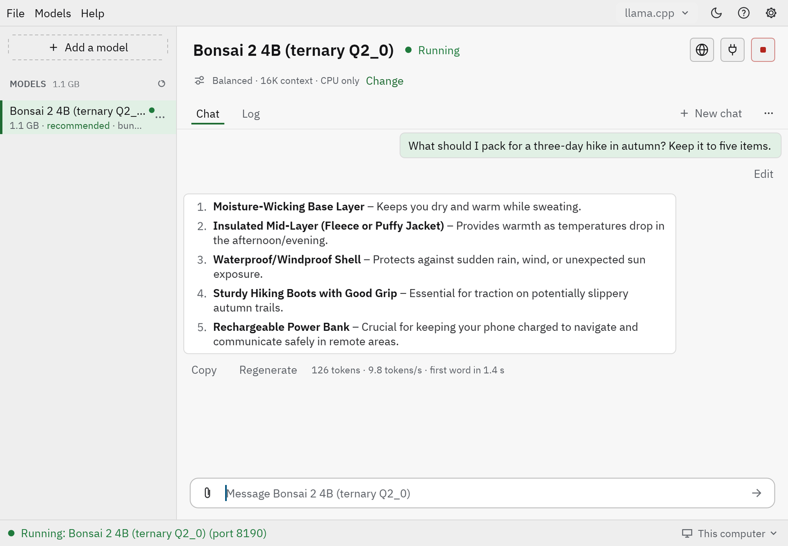

<p align="center">
  
</p>

<h1 align="center">QuickAI</h1>

<p align="center">
  <strong>Run AI models on your own computer. Private by default.</strong>
</p>

<p align="center">
  <a href="https://github.com/everybodyai/quickai/actions/workflows/ci.yml"></a>
  <a href="LICENSE"></a>
  
</p>

<p align="center">
  <a href="https://everybodyai.dev/quickai">Website</a> ·
  <a href="#install">Install</a> ·
  <a href="#quick-start">Quick start</a> ·
  <a href="docs/README.md">Docs</a>
</p>

<p align="center">
  <picture>
    <source media="(prefers-color-scheme: dark)" srcset="assets/readme/quickai-dark.png">
    
  </picture>
</p>

QuickAI is a lightweight desktop application that downloads, runs and manages AI models on the hardware you already
own, for chat, code, vision, speech, documents, images and video. You can type to it or speak to it. It requires no
account, uses no cloud service and collects no telemetry, and it is designed to keep your prompts on your computer.

## Why QuickAI

- **Private by default.** Models run on your computer, and the servers QuickAI starts listen on `127.0.0.1` only.
  There are no accounts, no update checks and no telemetry; nothing is sent to us. QuickAI connects to the internet
  only when you choose an action that requires it. [PRIVACY.md](PRIVACY.md) lists every host it can contact, and why.
- **Ready to use.** The packages whose names end in `-with-llamacpp-bonsai2-4b` include llama.cpp, Bonsai 2 4B
  (ternary weights, 1.2 GB) and a speech model, so your first chat requires no download. The application-only
  package is about 30 MB and downloads these components when you request them.
- **Voice (experimental).** Once you enable voice in **Settings → Voice**, the microphone in the chat transcribes
  what you say, **Read aloud** reads answers with a natural voice you download (Kokoro) or one of your own, and
  hands-free mode lets you hold a conversation without pressing anything. Your voice stays on your computer as well.
- **Runs on everyday hardware.** GPU acceleration through Vulkan on AMD, NVIDIA and Intel, and Metal on Apple
  silicon. Before you start a model, QuickAI suggests one that fits your memory and estimates how fast it will run
  on the graphics card, the processor, or both.
- **70+ recommended models.** A curated catalog for chat, reasoning, code, vision, document reading (OCR), speech,
  translation and search. Every file is verified against its SHA-256 checksum as it downloads.
- **Three engines.** llama.cpp is built in. [Ollama](https://ollama.com) and [ComfyUI](https://www.comfy.org)
  (images and video) are installed only on request, each in its own folder.
- **Tools for your model.** MCP servers let a model read files, fetch web pages and more, in QuickAI's own chat,
  whichever engine runs it.
- **Works with your other applications.** An OpenAI-compatible API on your own machine, for editors, scripts and
  chat clients. **Live traffic**, at the bottom of the window, shows each application's requests and the model's
  responses in real time.
- **Shareable configurations.** Save a complete setup (engine, model and settings) as a single small file and share
  it with others. Local paths and secrets are never exported.
- **Headless operation.** `quickai-headless` starts a configuration on a server without a display.

## Install

> QuickAI for Windows (zip), Linux (AppImage and tar.gz) and macOS (a single disk image for Apple silicon and Intel
> Macs) is available on the [Releases](https://github.com/everybodyai/quickai/releases) page. Packages for the AUR,
> Homebrew, Snap, Scoop, Chocolatey and the Microsoft Store will follow; to be notified when they are available, sign
> up at [everybodyai.dev](https://everybodyai.dev/quickai). You can also [build it from source](#build-from-source).

Two downloads are available for each platform:

- **Application only** (about 30 MB). QuickAI offers a llama.cpp build suited to your graphics card and a model to
  download, and downloads the speech model the first time you use the microphone.
- **With llama.cpp, Bonsai 2 4B and the speech model** (file names end in `-with-llamacpp-bonsai2-4b`, about 1 GB).
  Ready to run, with nothing to download first.

System requirements: Linux with glibc 2.34 or newer (Ubuntu 22.04 and later); Windows 10 or 11; macOS 13.3 (Ventura)
or later, with Metal on Apple silicon.

On macOS, drag QuickAI to the Applications folder. Until the app is notarized by Apple, macOS blocks it the first time
it is opened: choose **Done**, then click **Open Anyway** in **System Settings → Privacy & Security**. This is required
only once.

## Quick start

1. **Launch QuickAI.** With the bundled package, Bonsai 2 4B already appears in the model list. With the
   application-only package, click **Install llama.cpp** on the first page, then add a model with the **+** next to
   **MODELS**; the suggestions are tailored to your computer.
2. **Click Start** in the toolbar (or press Ctrl+Enter). The toolbar shows *Running* when the model is ready.
3. **Chat** in the box at the bottom of the page. While the model runs, the panel on the right becomes **Connect an
   app**, which shows the address for other applications, and **Open Chat UI** opens a chat in your browser. **Stop**,
   in the same toolbar, stops the model.

To add more models, click the **+** next to **MODELS**, then **Add a model…** (Ctrl+K). With the search box empty, it
suggests models suited to your computer; type keywords to search online, paste a link to download a file, or click the
folder icon to add a `.gguf` file you already have. **Recommended**, at the bottom of the sidebar, lists the full
curated catalog by category and size. To switch models, select one in the list and click **Start**. Right-clicking a
model offers **Details…**, **Show in folder** and **Delete…**; each row shows the model's size, whether it should run
fast on your computer, and whether it is the recommended choice for it. Add a model, model details, Help and About open
in separate windows that you can move and resize like any other window.

The panel on the right shows how the model runs: the context size (**4K** to **256K**, each with a dot that shows
whether it fits, and **Other…** offering more, up to 2M where the model supports it), whether it runs on the graphics
card, the processor or both, and the tools it may use. The button at the top of the panel hides it, and the button at the right end of the toolbar
shows it again.

Choose the engine under **This computer**, at the top of the sidebar. An engine that is not yet installed has an
**Install** button on its page; pulling a model starts Ollama automatically. Help (F1), with illustrated pages, a
button that highlights each part of the window and a short tour, About, and the light and dark theme are at the bottom
of the sidebar. Settings (Ctrl+,) is in the **QuickAI** menu at the top.

## Chat

The page below the toolbar is a chat with the running model, with nothing to install and no browser required.
Responses stream as they are generated, along with the generation speed (tokens per second). The paper clip attaches
an image for models that support vision, or inserts a text file into the message, and the wrench next to it offers the
tools of your MCP servers. A response can be copied or regenerated, and the last message can be edited and sent again.
The **⋯** menu at the right end of the toolbar contains **Keep chats**, **Options…** (instructions for the model, how
creative its responses are and their maximum length), **Hands-free** and **Export this chat…**, which saves the chat as
Markdown.

Conversations are not saved unless you enable **Keep chats** in that menu; each conversation is then stored as a file
on your computer.

Keyboard shortcuts: Ctrl+Enter starts or stops the model, Ctrl+K adds a model, Ctrl+L focuses the chat box, Ctrl+,
opens Settings and F1 opens Help. With voice enabled, hold Ctrl+Space to talk, and press Ctrl+Shift+Space to start or
end hands-free mode.

## Talk to it (experimental)

Voice is a new feature and is off until you enable **Use voice** in **Settings → Voice**; until then, QuickAI shows no
microphone and never opens it. Once enabled, the microphone in the chat box transcribes what you say: click it and
speak, or hold **Ctrl+Space**. Your words appear in the box, where you can edit them before sending. **Read aloud**
below a response reads it with a voice you install, highlighting the sentence being read. **Hands-free** (in the **⋯**
menu, or Ctrl+Shift+Space) listens, sends what you said when you pause, reads the response aloud and listens again;
press **Esc** to end it.

All processing happens on your computer: [quickai-whisper](https://github.com/everybodyai/quickai-whisper), built on
[whisper.cpp](https://github.com/ggml-org/whisper.cpp), transcribes your speech on the processor. The speech model
(82 MB) is included in the bundled packages and is otherwise downloaded on first use. **Settings → Voice** lets you set
the language you speak, choose larger speech models, and have every response read aloud, which is off by default.
For Urdu and most Indian languages, such as Malayalam, Tamil and Bengali, choose **Omnilingual** (Meta's Omnilingual
ASR, 1600 languages, 366 MB, downloaded on request), and for Arabic and Persian **Omnilingual large** (1.0 GB): Whisper
often writes these languages less accurately, in another script or as made-up words. For Hindi, **Whisper small** is
the most accurate, since Omnilingual often writes Hindi in Urdu's script. When you select your language, Settings
names the most accurate model for it. Omnilingual writes without capitals or punctuation.

QuickAI does not include a voice for reading aloud; choose one in **Settings → Voice → Read with**:

- **Kokoro**: natural voices for English, Hindi and seven other languages
  ([Kokoro-82M](https://huggingface.co/hexgrad/Kokoro-82M), Apache-2.0), downloaded on request (350 MB, or a smaller
  132 MB version), together with QuickAI's voice program
  [quickai-voice](https://github.com/everybodyai/quickai-voice) (GPL-3.0), built on
  [sherpa-onnx](https://github.com/k2-fsa/sherpa-onnx). Speech is generated on your computer.
- **Arabic, Persian and Urdu**: [Nabra](https://huggingface.co/oddadmix/Nabra-82M-v0.1), a Kokoro voice for Modern
  Standard Arabic (Apache-2.0, 83 MB), and the Piper voices Amir for Persian (CC0, 67 MB) and Fasih for Urdu (MIT,
  67 MB), downloaded on request in the same way.
- **The languages of India**: [Piper](https://github.com/rhasspy/piper) voices for Malayalam (Meera, Arjun), Telugu
  (Maya, Venkatesh) and Nepali (Chitwan), and Meta's [MMS](https://huggingface.co/facebook/mms-tts) voices for Tamil,
  Kannada, Marathi, Bengali, Gujarati, Punjabi, Odia and Assamese (63 to 114 MB each), downloaded on request. Each keeps
  its own license, which Settings shows: MMS's allows non-commercial use only, and the IndicTTS license of IIT Madras
  (Meera, Arjun, Maya) asks businesses to agree terms with it.
- **A voice from a folder**: any voice you have that sherpa-onnx can read, such as Kokoro, Kitten, Piper or Matcha.
- **A speech server**: a server that implements OpenAI's `/v1/audio/speech`, for voices QuickAI cannot run itself.
- **A program of your own**: a command that reads its input aloud.

## Give your model tools

**MCP servers**, at the bottom of the sidebar, adds servers that implement the Model Context Protocol, which let a
model read files, fetch web pages and more. Add a server by its command or address, or paste the JSON from its
documentation. QuickAI runs these servers on your computer and offers their tools in its chat (the wrench in the chat
box), with llama.cpp or Ollama, including for a model running on another computer. A prompt asks for your approval
before each call (**Allow once**, **Always allow**, **Deny**). llama.cpp's own chat page offers them as well.
[docs/mcp-servers.md](docs/mcp-servers.md) includes a worked example, servers to try, and troubleshooting steps for a
server that does not start.

## Run models on another computer

A desktop with a powerful graphics card, or a rented GPU server, can run the models while you use them from here:
click **This computer** at the top of the sidebar, choose **Add a computer…**, and enter its SSH address (hosts from
your `~/.ssh/config` are suggested). QuickAI tests the connection step by step and explains how to resolve any step
that fails; then select the computer in the same menu. The model list then shows the models stored on that computer;
**Start** runs the selected model there, and the chat and **Connect an app** work just as they do locally.

QuickAI connects using your own `ssh` client (your keys, agent and `~/.ssh/config` are used as they are) and opens no
network port on either side: the engine on the remote computer listens on its own loopback interface, and an SSH
tunnel forwards its port to this computer, on the same port number unless you specify another (**Port here**, under
the computer's **More options**). On the remote computer, run Ollama (or ComfyUI) as you normally would, or
`quickai-headless up` with a configuration.

## Use it from other apps

While a model runs, QuickAI serves an OpenAI-compatible API on your machine (**Connect an app**, in the panel on the
right, shows the details):

```bash
curl http://127.0.0.1:8080/v1/chat/completions \
  -H "Content-Type: application/json" \
  -d '{"model": "local", "messages": [{"role": "user", "content": "Hello!"}]}'
```

Any client that accepts a custom OpenAI base URL works: set it to `http://127.0.0.1:8080/v1`, with any API key.

## Engines

| Engine | Purpose | How to get it |
| --- | --- | --- |
| **llama.cpp** | Chat, code, vision and embeddings with any GGUF model | Built in |
| **Ollama** | The Ollama model library | Choose **Ollama** in the engine menu under **This computer**, then **Install Ollama**; downloaded and checksum-verified on request |
| **ComfyUI** | Images and video from workflows (Wan 2.2, LTX-Video and more) | Choose **ComfyUI** in the engine menu under **This computer**, then **Install ComfyUI**; installed from source into its own environment, with ComfyUI-Manager unless you deselect it |
| **Open WebUI** | A full-featured chat interface for Ollama | Settings → Open WebUI, with Ollama selected; offline by default |

Every engine QuickAI installs resides under `~/.quickai`, starts on `127.0.0.1` only, and has its own outbound
reporting disabled. Ollama, for example, runs with `OLLAMA_NO_CLOUD=1`.

## On a server

`quickai-headless` is QuickAI without the window, intended for rented GPU servers. It takes a configuration exported from
the application, installs what it requires, downloads the models, and starts it:

```bash
quickai-headless init  vision-chat.toml   # write the file of what this configuration needs from you
quickai-headless check vision-chat.toml   # show what would be done, from where, and how big; change nothing
quickai-headless up    vision-chat.toml   # do it, start it, stay until Ctrl-C
```

It listens on the loopback interface only; connect to it through an SSH tunnel. See
[docs/headless.md](docs/headless.md).

## Privacy

- Prompts and responses pass only between your browser or application and the local server. QuickAI does not send
  them anywhere else, and its developer never receives them.
- Voice is off until you enable it. Once enabled, speech captured by the microphone is transcribed on your computer,
  and the recording is not kept.
- There are no accounts, no automatic update checks and no telemetry. When a problem occurs (QuickAI crashes, an
  engine stops unexpectedly, or the window stops responding), QuickAI displays an anonymous report, and a single click
  opens QuickAI's website or a GitHub issue with the report pre-filled, for you to review and submit if you wish. See
  [PRIVACY.md](PRIVACY.md#problem-reports).
- The internet is used only when you search for or download a model or an engine, and the application indicates when
  it does so.
- If you install ComfyUI with its Manager (selected by default), the Manager downloads its lists of nodes and models
  from GitHub and the Comfy Registry each time ComfyUI starts. Custom nodes it installs are third-party software.
- Everything QuickAI stores (settings, configurations and downloaded models) remains in your own folders.
- QuickAI is designed so that nothing leaves your computer without your request. We take care to ensure this, but as
  no software is free of defects, it cannot be guaranteed; see [PRIVACY.md](PRIVACY.md#limitations).

The full policy is available in [PRIVACY.md](PRIVACY.md).

## Build from source

```bash
git clone https://github.com/everybodyai/quickai
cd quickai
cargo run --release -p quickai
```

To run a model, you also need a llama.cpp build, and for the microphone, the speech program from
[quickai-whisper's releases](https://github.com/everybodyai/quickai-whisper/releases).
[docs/development.md](docs/development.md) covers the setup, the code layout, and the checks CI runs.

## License

QuickAI is open source under the [MIT License](LICENSE): you may use it for any purpose, personal or commercial, and
modify and redistribute it. It is provided "as is", without warranty of any kind. Organizations that need assistance
deploying QuickAI can obtain paid help and support from EverybodyAI: see
[everybodyai.dev/organizations](https://everybodyai.dev/organizations).

The components QuickAI bundles or downloads retain their own licenses
([THIRD_PARTY_LICENSES.md](THIRD_PARTY_LICENSES.md)), and each model you download is subject to its own license.

## Contributing

Bug reports, ideas and pull requests are welcome; please read [CONTRIBUTING.md](CONTRIBUTING.md) first.
Contributions are accepted under the MIT License, the same license as the code, and all participants are expected to
follow the [Code of Conduct](CODE_OF_CONDUCT.md). Please report security issues privately, as described in
[SECURITY.md](SECURITY.md).

---

<p align="center">
  QuickAI is made by <a href="https://everybodyai.dev"><strong>EverybodyAI</strong></a>: tools that make AI usable by everybody, privately.
</p>
